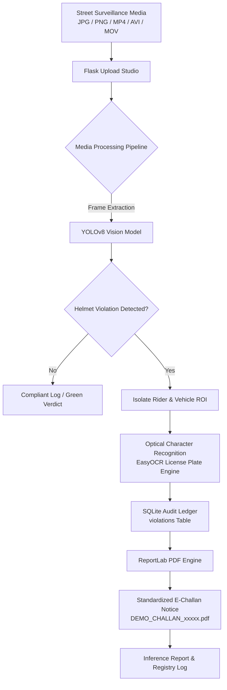

# 🛡️ HelmetGuard — AI Traffic Vision & E-Challan Enforcement System

[](https://www.python.org/)
[](https://flask.palletsprojects.com/)
[](https://ultralytics.com/)
[](https://github.com/JaidedAI/EasyOCR)
[](https://www.reportlab.com/)
[](#user-interface)

**HelmetGuard** is a full-stack, AI-driven traffic surveillance and automated enforcement platform. It ingests street-level camera images and video footage, detects two-wheeler riders operating without helmets, extracts vehicle registration plates, logs infractions into an encrypted central audit ledger, and automatically generates legal-grade **E-Challan PDF notices** complete with photographic evidence frames.

Designed with a **Squarespace-grade editorial dark luxury interface**, the platform offers a streamlined experience with drag-and-drop media upload, 1-click test presets, live telemetry status, and an interactive violations registry.

---

## 📑 Table of Contents

- [Key Features](#-key-features)
- [System Architecture](#-system-architecture)
- [Project Structure](#-project-structure)
- [Prerequisites](#-prerequisites)
- [Step-by-Step Installation](#-step-by-step-installation)
  - [1. Clone Repository](#1-clone-repository)
  - [2. Create & Activate Virtual Environment](#2-create--activate-virtual-environment)
  - [3. Install Dependencies](#3-install-dependencies)
  - [4. Configure Environment Variables](#4-configure-environment-variables)
  - [5. Model Weights Setup](#5-model-weights-setup)
- [Running the Project](#-running-the-project)
- [User Guide & Workflows](#-user-guide--workflows)
- [API & Route Reference](#-api--route-reference)
- [Configuration Options](#-configuration-options)
- [Troubleshooting & FAQs](#-troubleshooting--faqs)
- [Legal Disclaimer](#-legal-disclaimer)

---

## ✨ Key Features

- **Sub-Second Neural Object Detection**: Powered by **Ultralytics YOLOv8** to identify motorcycles, riders, helmet compliance, and bare-head riders across varying lighting conditions.
- **Automated Plate OCR**: Integrates **EasyOCR** text segmentation with regional Indian authority prefix mapping (e.g., `DL`, `MH`, `KA`, `GJ`, `TS`, `TN`).
- **Cryptographic E-Challan Generation**: Built with **ReportLab** to generate tamper-evident, formatted A4 PDF penalty notices embedding cropped violation frames, timestamps, and fine amounts.
- **Squarespace Editorial Dark Design**:
  - Fluid Bento Grid modular features.
  - Interactive Upload Studio with quick presets (*"Test Rider Without Helmet"* / *"Test Rider With Helmet"*).
  - High-contrast typography featuring Google Fonts (*Plus Jakarta Sans* & *Space Grotesk*).
  - Minimalist pill action buttons with smooth micro-interactions.
- **Central Violations Registry**: Real-time searchable database with instantaneous license plate filtering, evidence review, and 1-click PDF download.
- **Cross-Platform Resilience**: Works seamlessly across Windows, Linux, and macOS with automatic path normalization and defensive fallbacks when custom weights are being loaded.

---

## 🏛️ System Architecture



---

## 📂 Project Structure

```text
pooja/
├── app.py                     # Primary Flask application & computer vision pipeline
├── requirements.txt           # Python dependencies (Flask, OpenCV, YOLO, EasyOCR, ReportLab)
├── .env                       # Environment configuration file
├── yolov8n.pt                 # YOLOv8 baseline model weights
│
├── data/                      # Persistent storage directory (auto-created)
│   ├── uploads/               # Raw uploaded media files
│   ├── results/               # Annotated evidence images and processed video clips
│   ├── challans/              # Generated E-Challan PDF notices
│   └── helmet_challans.db     # SQLite central audit database
│
├── static/                    # Frontend assets
│   ├── css/
│   │   └── style.css          # Squarespace Design System stylesheet
│   ├── js/
│   │   └── main.js            # Drag-and-drop, sample loaders, and micro-interactions
│   ├── samples/               # Included test media for instant 1-click demos
│   │   ├── sample_nohelmet.jpg
│   │   └── sample_helmet.jpg
│   ├── favicon.ico            # Platform icon
│   └── favicon.svg
│
└── templates/                 # Jinja2 HTML templates
    ├── index.html             # Homepage: Hero, Studio, Bento Grid, Recent Violations
    ├── result.html            # Inference Report: Evidence viewer & Challan card grid
    └── violations.html        # Central Registry: Searchable table & telemetry metrics
```

---

## 💻 Prerequisites

Ensure your system meets the following requirements:

1. **Python**: Version **3.10** or higher ([Download Python](https://www.python.org/downloads/)).
2. **Git**: Version 2.30+ ([Download Git](https://git-scm.com/)).
3. **Pip & Virtualenv**: Included with standard Python installations.
4. **Hardware**: Any modern multi-core CPU. GPU (NVIDIA CUDA) is automatically utilized by PyTorch/Ultralytics if available.

---

## 🚀 Step-by-Step Installation

### 1. Clone Repository

Clone the project to your local workstation:

```bash
git clone https://github.com/vishalreddy315/pooja.git
cd pooja
```

---

### 2. Create & Activate Virtual Environment

Isolate your project dependencies by creating a dedicated virtual environment:

#### Windows (PowerShell):
```powershell
python -m venv venv
.\venv\Scripts\Activate.ps1
```
*(If PowerShell restricts script execution, run: `Set-ExecutionPolicy -Scope CurrentUser -ExecutionPolicy RemoteSigned`)*

#### Windows (Command Prompt):
```cmd
python -m venv venv
venv\Scripts\activate.bat
```

#### macOS / Linux:
```bash
python3 -m venv venv
source venv/bin/activate
```

---

### 3. Install Dependencies

Install all required packages from `requirements.txt`:

```bash
pip install --upgrade pip
pip install -r requirements.txt
```

> **Note on PyTorch / Torchvision**: If you wish to utilize an NVIDIA GPU with CUDA acceleration, install the matching PyTorch version from [pytorch.org](https://pytorch.org/get-started/locally/) before installing `requirements.txt`.

---

### 4. Configure Environment Variables

Create or update the `.env` file in the project root:

```ini
FLASK_APP=app.py
FLASK_ENV=development
FLASK_DEBUG=1
SECRET_KEY=helmetguard-secure-session-key-2026
DEMO_FINE_INR=500
HELMET_MODEL=models/helmet_best.pt
```

| Variable | Description | Default |
| :--- | :--- | :--- |
| `FLASK_APP` | Main application entrypoint | `app.py` |
| `FLASK_DEBUG` | Enables automatic reloading and debugging | `1` |
| `SECRET_KEY` | Flash messages and session encryption key | `change-this-for-local-demo` |
| `DEMO_FINE_INR` | Penalty fine amount calculated on challans | `500` |
| `HELMET_MODEL` | Custom trained helmet YOLO weights path | `models/helmet_best.pt` |

---

### 5. Model Weights Setup

The application features built-in dual-mode operation:

1. **General / Demo Mode (Default)**:
   - Uses `yolov8n.pt` (automatically verified and included).
   - Ideal for testing system flow, OCR, PDF generation, and UI interactions without needing custom-trained weights.
2. **Custom Trained Helmet Model (Optional)**:
   - If you have a custom trained YOLO model (with classes such as `helmet` and `no_helmet`), place your `.pt` file in `models/helmet_best.pt` or point the `HELMET_MODEL` environment variable to its location.

---

## 🏃 Running the Project

Start the local Flask development server:

```powershell
python app.py
```

You should see output similar to:
```text
 * Serving Flask app 'app'
 * Debug mode: on
 * Running on http://127.0.0.1:5000
Press CTRL+C to quit
```

Open your browser and navigate to:
👉 **[http://127.0.0.1:5000](http://127.0.0.1:5000)**

---

## 🖥️ User Guide & Workflows

### 1. Instant 1-Click Testing (Preset Buttons)
On the homepage, navigate to the **Detection Studio** section:
- Click **"Test Rider Without Helmet"**: Instantly stages `sample_nohelmet.jpg`, displays file metadata, and enables the submission button.
- Click **"Execute AI Detection →"**: Runs the neural inference pipeline, logs the infraction, creates the e-challan, and redirects to the **Inference Report**.

### 2. Custom Media Upload
- Drag & drop any `.jpg`, `.png`, `.mp4`, `.avi`, or `.mov` file into the dropzone (up to 100 MB).
- The file card displays name and file size. Click **"Execute AI Detection →"** to analyze.

### 3. Reviewing Generated E-Challans
- On the **Inference Report** page (`/upload`), view the annotated visual evidence bounding boxes.
- Click **"Download PDF Challan →"** to download the official legal-formatted notice.

### 4. Central Violations Registry
- Visit **`/violations`** via the top navigation bar.
- Use the **instant search bar** to filter by vehicle plate (e.g. `DL 01`, `MH 12`), Challan ID, or timestamp.
- Click **"View"** to inspect evidence crops or **"PDF"** to redownload any historical challan.

---

## 🌐 API & Route Reference

| Method | Route | Description |
| :--- | :--- | :--- |
| `GET` | `/` | Main dashboard (Hero, Studio, Bento Grid, Recent Violations) |
| `POST` | `/upload` | Ingests media file, executes detection pipeline, renders report |
| `GET` | `/violations` | Searchable central registry table and telemetry counters |
| `GET` | `/results/<filename>` | Serves annotated evidence images or processed video files |
| `GET` | `/challans/<filename>`| Downloads generated PDF E-Challan files |
| `GET` | `/static/samples/<file>`| Serves preset demo test images |

---

## 🔧 Database Schema

The SQLite database at `data/helmet_challans.db` maintains the following schema:

```sql
CREATE TABLE violations (
    id INTEGER PRIMARY KEY AUTOINCREMENT,
    created_at TEXT NOT NULL,
    source_name TEXT NOT NULL,
    vehicle_number TEXT NOT NULL,
    violation TEXT NOT NULL,
    confidence REAL,
    evidence_path TEXT,
    challan_path TEXT,
    amount REAL NOT NULL,
    status TEXT NOT NULL DEFAULT 'DEMO ONLY'
);
```

---

## ❓ Troubleshooting & FAQs

### Q1: `ModuleNotFoundError: No module named 'ultralytics'` or `'easyocr'`
**Solution**: Make sure your virtual environment is activated (`(venv)` appears in your prompt) and execute:
```bash
pip install -r requirements.txt
```

### Q2: Video processing is slow on CPU
**Solution**: Video frame inference processes every frame through YOLO. For faster execution on long videos without an NVIDIA GPU, test with short 3–10 second clips or use high-resolution images.

### Q3: PDF challans are missing evidence images
**Solution**: The application uses forward-slash path resolution across all operating systems. Ensure `data/results` contains write permissions for the local Python process.

### Q4: Port 5000 is already in use
**Solution**: Run the application on a different port:
```powershell
python -c "from app import app; app.run(port=5001, debug=True)"
```
Then visit `http://127.0.0.1:5001`.

---

## ⚖️ Legal Disclaimer

This repository is built for **educational, demonstrative, and research purposes**. All generated e-challans, license plates, and violation logs are marked **"DEMO ONLY"** and do not represent legally enforceable traffic citations issued by any statutory authority.

---

<p align="center">
  Crafted with precision using the <strong>Squarespace Dark Luxury Design System</strong> • 2026
</p>
